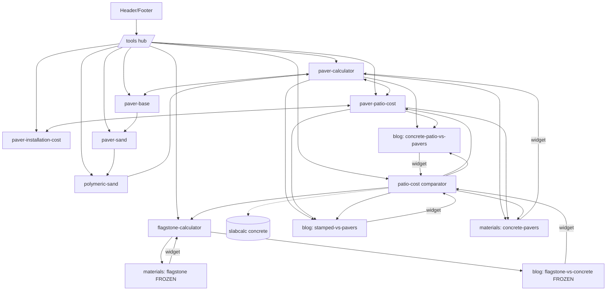

# Cross-link Map

Targets from the build guide: 25–35 internal links in `<main>` per tool page, at least 3 links into every new URL from **indexed** pages, anchors = real page titles or natural phrases. Never use exact-match anchor spam.

## 1. Intra-hub: tools ↔ tools (paving cluster)

The tools form a project chain plus a cost/quantity pair. Every tool shows **Related Tools** (6–8) at the bottom and calls out the "next step" tool inside its result card.

| From | Next-step CTA in result card | Related Tools block |
|---|---|---|
| paver-calculator | "Price it → paver patio cost calculator" | paver-base, paver-sand, polymeric-sand, paver-patio-cost, paver-installation-cost, patio-cost, flagstone |
| paver-patio-cost-calculator | "Get quantities → paver calculator" | paver-installation-cost, patio-cost, paver-calculator, paver-base, polymeric-sand, paver-walkway-cost, paver-driveway-cost |
| paver-installation-cost-calculator | "Material list → paver calculator" | paver-patio-cost, paver-calculator, paver-base, paver-sand, polymeric-sand, patio-cost |
| paver-base-calculator | "Next layer → paver sand calculator" | paver-calculator, paver-sand, polymeric-sand, paver-installation-cost, paver-patio-cost |
| paver-sand-calculator | "Joints → polymeric sand calculator" | paver-base, polymeric-sand, paver-calculator, paver-patio-cost |
| polymeric-sand-calculator | "Whole project → paver calculator" | paver-sand, paver-base, paver-calculator, paver-patio-cost |
| patio-cost-calculator | per-material row links: pavers → paver-patio-cost, flagstone → flagstone-calculator, concrete → slabcalc | paver-patio-cost, flagstone, paver-calculator, paver-installation-cost, (P2) concrete-finish-selector |
| flagstone-calculator | "Compare materials → patio cost calculator" | patio-cost, paver-calculator, paver-base, paver-patio-cost |
| P2 selectors | each recommended finish links its /materials page | the other two selectors + patio-cost |

## 2. Inter-hub: tools ↔ content

| Tool | Related Guides (5–7) + inline body links |
|---|---|
| paver-calculator | /materials/concrete-pavers, /blog/patio/concrete-patio-vs-pavers, /blog/patio/stamped-concrete-vs-pavers, /guides/concrete-patio, /patio, inspiration paver/brick tiles |
| paver-patio-cost-calculator | /blog/patio/concrete-patio-vs-pavers, /blog/patio/stamped-concrete-vs-pavers, /materials/concrete-pavers, /blog/patio/concrete-patio-ideas, /patio |
| paver-installation-cost-calculator | /materials/concrete-pavers, /blog/patio/concrete-patio-vs-pavers, /guides/concrete-patio |
| paver-base / sand / polymeric | /materials/concrete-pavers, /blog/patio/concrete-patio-vs-pavers, /guides/concrete-walkway |
| patio-cost-calculator | /blog/walkway/flagstone-vs-concrete-walkway, /blog/patio/concrete-patio-vs-pavers, /blog/patio/stamped-concrete-vs-pavers, /materials/flagstone, /materials/stamped-concrete, /materials/exposed-aggregate, /blog/patio/concrete-patio-cost |
| flagstone-calculator | /materials/flagstone, /blog/walkway/flagstone-vs-concrete-walkway, /inspiration/flagstone-patio-grey, /inspiration/flagstone-walkway-natural |
| P2 finish selectors | /materials/broom-finish, /materials/exposed-aggregate, /materials/stamped-concrete, /blog/patio/best-concrete-finish-pool-deck, /blog/patio/exposed-aggregate-vs-broom-finish |

**Content → tools (new links INTO tools, additive):**

| Source (index status) | Link added | Tool |
|---|---|---|
| /blog/walkway/flagstone-vs-concrete-walkway (indexed, FROZEN) | widget + Related Tools line | patio-cost, flagstone |
| /blog/patio/concrete-patio-vs-pavers (indexed) | widget + inline | patio-cost, paver-patio-cost |
| /blog/patio/stamped-concrete-vs-pavers (indexed) | widget + inline | patio-cost, paver-patio-cost |
| /materials/concrete-pavers (indexed) | widget + inline | paver-calculator, paver-base, polymeric-sand |
| /materials/flagstone (indexed, FROZEN) | widget | flagstone-calculator |
| /blog/patio/concrete-patio-ideas (indexed) | inline (appended section) | patio-cost |
| /patio, /walkway, /driveway landings | "Plan & price it" tool strip | paver-patio-cost, paver-walkway-cost, paver-driveway-cost |
| Footer (sitewide) | Free Tools column | 5 tools + /tools |
| Header (sitewide) | Tools | /tools |
| /materials hub | "Calculators" row | paver, flagstone |
| Inspiration tiles with paver/brick/flagstone material | 1 contextual line under the hero | matching tool |

## 3. ArticlePage / MaterialPage generic additions

- The old `ToolWaitlistBlock` (waitlist for the AI visualizer) stays on pages without a tool. On pages with `toolWidget` it is replaced by a "Related tools" mini-list. That is an additive swap below the content, not in the frozen intro area.

## 4. slabcalc hand-offs (outbound, `rel` normal, max 2–3 per page)

| Where | Link |
|---|---|
| patio-cost-calculator, concrete row | slabcalc.co/calculators/concrete-patio-cost-calculator |
| patio-cost-calculator, stamped row | slabcalc.co/calculators/stamped-concrete-cost-calculator |
| paver-base-calculator body ("pouring a slab instead?") | slabcalc.co/calculators/concrete-slab-calculator |
| paver-driveway-cost-calculator, concrete comparison | slabcalc.co/calculators/concrete-driveway-cost-calculator |
| P2 pool-deck selector, cost line | slabcalc.co/calculators/concrete-pool-deck-cost-calculator |

Reverse links (slabcalc → pourcanvas) belong to the slabcalc repo and are tracked as a separate follow-up. They aren't part of this refactor's code. Candidate slabcalc pages to add them on: stamped cost calculator ("choose a pattern"), pool deck cost calculator ("which finish"), the patio cost calculator ("pavers instead?").

## 5. Hub structure graph

